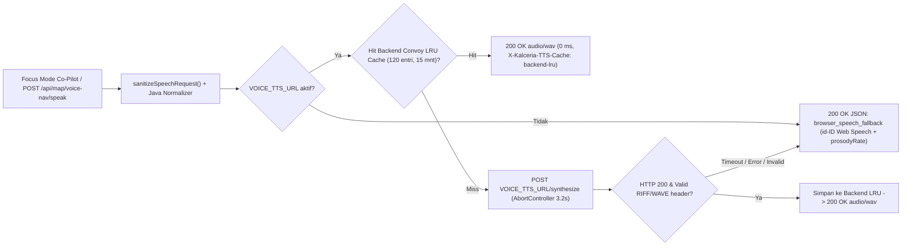

# ITERATION 4/5 — DOCKER NEURAL VOICE TTS (PIPER MIT ONNX) + PRE-BAKED CACHE & BACKEND `/speak` PROXY

**Iteration:** `4 / 5`  
**Date:** 2026-11-27  
**Parent Plan:** [AI_VOICE_NAVIGATION_MASTER_PLAN.md](file:///d:/TheWeb/Kalceria/docs/AI_VOICE_NAVIGATION_MASTER_PLAN.md)  
**Previous Iteration:** [ITERATION_3_INFERENCE_AND_TRIGGERS.md](file:///d:/TheWeb/Kalceria/docs/ITERATION_3_INFERENCE_AND_TRIGGERS.md)

---

## 1. Tujuan Iterasi 4/5
1. Membangun **Microservice Docker Neural Voice TTS Bahasa Indonesia 100% Bebas Copyright** berbasis model open-source Hugging Face **`rhasspy/piper-voices` (`id_ID-news_tts-medium`, MIT License)** yang berjalan ringan di CPU tanpa GPU (`<= 512 MB` RAM), berdampingan langsung dengan stack Docker OSRM Pulau Jawa (`infra/osrm-java/`).
2. Membangun strategi **3-Tier Audio Caching** (*Pre-Baked Disk WAVs* → *Docker LRU RAM* → *Backend Convoy LRU RAM*) agar instruksi belokan mendesak (*"Belok kiri sekarang."*) diputar instan `< 2 ms`.
3. Membangun proxy backend `POST /api/map/voice-nav/speak` dan `GET /api/map/voice-nav/tts-health` yang **100% kebal error (zero-crash)** dengan degradasi otomatis mulus ke `browser_speech_fallback` (`id-ID` Web Speech API) ketika container TTS belum di-deploy atau mengalami latensi jaringan.

---

## 2. Arsitektur Microservice Docker Neural TTS (`infra/voice-tts-id/`)

| File | Fungsi Utama |
|---|---|
| [Dockerfile](file:///d:/TheWeb/Kalceria/infra/voice-tts-id/Dockerfile) | Base `python:3.11-slim` + `espeak-ng` + `piper-tts` + `onnxruntime` CPU. Mengunduh model resmi MIT `id_ID-news_tts-medium.onnx` & `.onnx.json` dari Hugging Face saat build, lalu menjalankan pre-baking otomatis untuk 18 frasa inti. |
| [prebake_phrases.py](file:///d:/TheWeb/Kalceria/infra/voice-tts-id/prebake_phrases.py) & [static_phrases_id.json](file:///d:/TheWeb/Kalceria/infra/voice-tts-id/static_phrases_id.json) | Mem-pre-bake 18 frasa navigasi Indonesia bebas-slot (*"Belok kiri sekarang."*, *"Putar balik sekarang jika aman."*, *"Hati-hati, perlintasan rel kereta api di depan."*, *"Anda telah tiba..."*, dll.) ke WAV `22.05 kHz` menggunakan kunci deterministik SHA-256 `(model, prosodyRate, text)`. |
| [server.py](file:///d:/TheWeb/Kalceria/infra/voice-tts-id/server.py) | Server FastAPI + Uvicorn port `5055`: `GET /health` & `POST /synthesize` (`audio/wav`). Memetakan `prosodyRate` dari Vector-Attention (`0.98–1.08`) menjadi `length_scale = 1 / prosodyRate` pada `SynthesisConfig` Piper VITS (kompatibel baik dengan `piper-tts >= 1.3` maupun `1.2.x`). |
| [docker-compose.yml](file:///d:/TheWeb/Kalceria/infra/voice-tts-id/docker-compose.yml) | Menjalankan `kalceria-voice-tts-id` mandiri pada `:5055` (`mem_limit: 512m`). |
| [docker-compose.java-nav.yml](file:///d:/TheWeb/Kalceria/infra/docker-compose.java-nav.yml) | **Unified Pulau Jawa Navigation Stack**: menjalankan `osrm-java-foot (:5001)`, `osrm-java-motorcycle (:5002)`, `osrm-java-car (:5003)`, dan `voice-tts-id (:5055)` bersama dalam 1 perintah `docker compose up -d --build`. |

---

## 3. Arsitektur Proxy Backend & Fallback Zero-Crash

### Modul Backend Baru & Endpoint Terdaftar
- **Service**: [ttsSynthesisService.js](file:///d:/TheWeb/Kalceria/backend/services/voiceNav/ttsSynthesisService.js)
  - `sanitizeSpeechRequest()`: membersihkan karakter kontrol, normalisasi singkatan jalan Pulau Jawa (`Jl.` → `Jalan`, `Bundaran HI` → `Bundaran Ha I`), clamp teks `<= 300` karakter, clamp `prosodyRate` ke `[0.85, 1.20]`.
  - `isValidWavBuffer()`: memverifikasi header biner `RIFF....WAVE` (`> 44 bytes`, `<= 2 MB`) agar audio korup tidak pernah dikirim ke browser.
  - `synthesizeVoiceNavSpeech()`: cache LRU lintas anggota konvoi Group Location Blend + degradasi mulus tanpa HTTP 500.
- **Controller & Routes**: [voiceNavController.js](file:///d:/TheWeb/Kalceria/backend/controllers/voiceNavController.js) & [backend/routes/index.js](file:///d:/TheWeb/Kalceria/backend/routes/index.js)
  - `POST /api/map/voice-nav/speak` (`requireAuth`) — menerima `{ text, prosodyRate, urgency }` **atau** one-shot `{ context, slots }` (otomatis menjalankan Vector-Attention lalu sintesis suara!).
  - `GET /api/map/voice-nav/tts-health` (`requireAuth`) — memantau status container Neural Piper & mode aktif (`neural_wav` vs `browser_speech_fallback`).

---

## 4. Jaminan Lisensi Bebas Copyright
- **Model Utama**: `rhasspy/piper-voices` (`id/id_ID/news_tts/medium/id_ID-news_tts-medium.onnx`) — **MIT License** (bebas komersial, bebas royalti, bebas klaim copyright).
- **Zero Non-Commercial Models**: Unit test secara eksplisit memastikan tidak ada referensi ke model non-komersial (`facebook/mms-tts-ind` / `CC-BY-NC-4.0`) di seluruh direktori `infra/voice-tts-id/`.

---

## 5. Verifikasi & Handoff ke Iterasi 5/5
- **Unit Test Iterasi 4/5**: [voice_nav_iter4_docker_tts.test.mjs](file:///d:/TheWeb/Kalceria/backend/tests/voice_nav_iter4_docker_tts.test.mjs) (audit Dockerfile & URL HF MIT, kompilasi sintaks Python `py_compile`, uji RIFF/WAVE validation, uji Backend LRU Cache 1-call deduplication, uji degradasi aman pada timeout/corrupt payload).
- **Handoff ke Iterasi 5/5 (`proceed 5/5` — Final Production Launch!)**:
  1. Integrasi penuh **AI Voice Co-Pilot** ke Focus Mode Group Location Blend di Frontend (`frontend/components/map/blend/voiceNav/`): memuat bundle 26 KB dari `/api/map/voice-nav/bundle`, menjalankan inferensi `< 0.1 ms` langsung di browser pada setiap GPS tick, memutar audio Neural WAV dari `/api/map/voice-nav/speak` dengan fallback instan `speechSynthesis` (`id-ID`) + audio ducking sinkron dengan `soundEngine.js`.
  2. Menambahkan tombol **AI Voice (On/Mute + Test Voice)** dan **Live Subtitle Ticker** elegan pada `BlendFocusHud.jsx` & `MapBlendController.jsx` (**0 Hook Delta** pada Tier A `MapPageClient.jsx` & `usePersonalChatState.js`).
  3. Full Next.js build + Backend & Frontend production deploy + live smoke probes + `docs/ITERATION_5_COPILOT_PRODUCTION_LAUNCH.md`.

