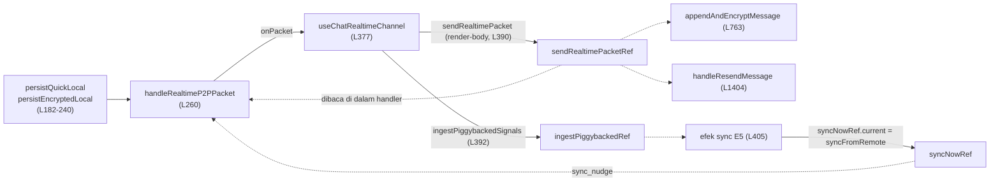
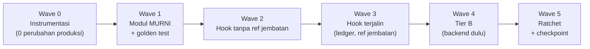

# KALCERIA MODULARIZATION STRATEGY (Versi Final, Level Subatomik)

**Status dokumen:** DISETUJUI programmer · belum ada kode produksi yang diubah
**Acuan baseline kode:** commit `f1dbb70` (kode identik dengan `6926af6`; beda hanya `AGENTS.md` dan `TEST.md`, sudah diverifikasi dengan `git diff --stat`)
**Semua nomor baris di dokumen ini merujuk ke `f1dbb70`.** Setelah ekstraksi dimulai, nomor itu hanya valid lewat `git show f1dbb70:<path>`.
**Dokumen pasangan:** [AGENTS.md](file:///d:/TheWeb/Kalceria/.agents/rules/AGENTS.md) §6 (aturan mengikat, ringkas). Dokumen ini adalah penjelasan lengkapnya.
**Dokumen historis terkait:** [FRONTEND_REFACTOR_AUDIT.md](file:///d:/TheWeb/Kalceria/docs/FRONTEND_REFACTOR_AUDIT.md) (audit era `RefactorFrontend`; angka ukurannya sudah usang, tetapi mencatat bahwa lint frontend sudah gagal di baseline lama).

---

## 0. Keputusan Programmer (final)

| # | Keputusan | Konsekuensi |
|---|---|---|
| 1 | Menambah lapisan bukti baru: `frontend/tests/`, `scripts/audit/`, Gate 3b, Gate 3c | Wave 0 membangunnya. Gate 3b/3c baru **wajib** setelah Wave 0 selesai |
| 2 | Tier C (44 file 300–499 baris) **tidak diubah** | Hanya dijaga ratchet ukuran |
| 3 | Test besar (≥500 baris, 7 file) **dibiarkan** | Dikecualikan dari KPI ukuran; daftar file Gate 3 tidak berubah |
| 4 | Programmer menjalankan matriks uji manual di perangkat nyata | Matriks §12 menjadi gerbang tiap wave |
| 5 | Eksekusi langsung, **selalu push ke `main`**, **`BaselineNovember#2` tidak disentuh sama sekali** | Aturan git §11.3 |
| 6 | Pada putaran ini **tidak ada kode yang diedit**; hanya dokumentasi | Wave 0 dimulai pada perintah berikutnya |

---

## 1. Evaluasi Artifact Lama (Gemini 3.8 Flash)

Artifact lama (`kalceria_modularization_strategy_and_census.md`) **dinyatakan tidak berlaku**. Arahnya benar (facade + sub-hook, tanpa library baru), tetapi 9 cacat membuatnya tidak aman dieksekusi:

| # | Klaim lama | Fakta audit | Dampak bila dieksekusi |
|---|---|---|---|
| 1 | 1.509 / 1.479 / 923 baris | **1.632 / 1.604 / 980** (`Measure-Object -Line` mengabaikan baris kosong) | KPI meleset ~8% |
| 2 | Cache = "AES-GCM / IndexedDB" | `sessionStorage` (quick) + `localStorage` terenkripsi lewat [chatCrypto](file:///d:/TheWeb/Kalceria/frontend/lib/chatCrypto.js). IndexedDB hanya untuk blob media pending ([chatMediaStore](file:///d:/TheWeb/Kalceria/frontend/lib/chatMediaStore.js)) | Modul dirancang di atas asumsi salah |
| 3 | `handleSaveEvent`/`handleDeleteEvent` | Nama asli `saveMiniEvent`/`deleteMiniEvent`, fungsi biasa (bukan `useCallback`) | Halusinasi signature (AGENTS §1.2) |
| 4 | Target facade ~350/~380 | Bottom-up: Chat ≈ 400, Map ≈ 450–500 | KPI palsu |
| 5 | Folder `personalChat/`, `mapPage/` "baru" | Keduanya sudah ada | Konflik penamaan |
| 6 | Blok terbesar tak terpetakan | Efek sync 304, `appendAndEncryptMessage` 272, `saveMiniEvent` 175, `sidebarKalcerians` 129 | Sumber kompleksitas tak tersentuh |
| 7 | Hazard hanya "referential stability" | Ada 10 jebakan spesifik (§3) | Regresi senyap |
| 8 | Bukti = 4 gate + `git diff BaselineNovember#2` | **Frontend tidak punya test.** Diff refactor hanya menampilkan "file berubah total" | Gate lolos walau UI rusak |
| 9 | Diff terhadap branch `BaselineNovember#2` | AGENTS melarang checkout; branch itu = `main` HEAD | Diff kosong atau melanggar aturan |

Catatan tambahan atas diri saya sendiri: artifact pertama yang saya tulis di sesi ini memuat kesalahan yang sama (butir 1, 3, 8). Dokumen ini mengoreksinya.

---

## 2. Sensus Akurat (LOC dihitung dengan `ReadAllLines`)

Total file kode ≥300 baris: **63** (56 produksi + 7 test).

| Tier | Rentang | Produksi | Test | Perlakuan |
|---|---|---:|---:|---|
| **A** Kritis | ≥ 800 | 2 | 1 | Dekomposisi penuh (§4–§8) |
| **B** Menengah | 500–799 | 10 | 2 | Dekomposisi per file (§9) |
| **C** Pengawasan | 300–499 | 44 | 4 | **Tidak diubah**; ratchet saja |

**Tier A**

| File | LOC | useState | useEffect | useCallback | useMemo | useRef |
|---|---:|---:|---:|---:|---:|---:|
| [MapPageClient.jsx](file:///d:/TheWeb/Kalceria/frontend/components/map/MapPageClient.jsx) | 1.632 | 35 | 11 | 21 | 5 | 2 |
| [usePersonalChatState.js](file:///d:/TheWeb/Kalceria/frontend/components/map/chat/hooks/usePersonalChatState.js) | 1.604 | 20 | 7 | 9 | 1 | 17 |
| `backend/tests/chat_call_bi_devices_slice.test.mjs` | 980 | (test, dikecualikan) | | | | |

Angka tabel ini adalah **Hook Inventory Baseline** (KPI K3). Total lintas file hasil refactor harus sama persis.

**Tier B (produksi):** `personalChatController.js` 673 · `miniEventHandlers.js` 654 · `KalceriansPanel.jsx` 648 · `CameraCaptureModal.jsx` 637 · `ChatMediaCard.jsx` 625 · `popupCarouselController.js` 618 · `EditProfileModal.jsx` 597 · `useMapChatAndNotifications.js` 563 · `useCallSession.js` 557 · `dashboard.jsx` 553.

---

## 3. Sepuluh Hukum Besi (Iron Laws)

Pelanggaran satu pun = ekstraksi dibatalkan (`git revert`) dan dihitung sebagai kegagalan AGENTS §5.

| ID | Hukum | Alasan teknis (bukti di kode) |
|---|---|---|
| **IL-1** | **Irisan Kontigu.** Hanya mengekstrak rangkaian blok yang berurutan dalam *Hook Ledger*. Modul yang memuat efek harus menempati posisi ledger yang sama | React menjalankan efek dan cleanup menurut urutan deklarasi. Contoh: cleanup efek `[242]` mengakses `persistDebounceRef` yang juga dipakai efek sync `[405]` |
| **IL-2** | **Registri Kepemilikan.** Semua `useState` dan `useRef` yang dipakai lintas blok **dibuat di facade** dan disuntik lewat parameter-object. Modul tidak boleh membuat state/ref bersama | Menjaga K3 secara konstruksi dan mencegah ref ganda |
| **IL-3** | **Assignment ref di render-body tetap di render-body**, pada posisi relatif yang sama | `sendRealtimePacketRef.current = …` (L390), `isP2PConnectedRef` (L389), `ingestPiggybackedRef` (L392), `activeChatUserRef`/`onOutgoingMessageUpdateRef`/`onCallEndedRef` (L168–170), `voiceRecorderRef` (L136). Memindah ke `useEffect` membuat nilai basi satu render dan memecah jembatan siklus (§4.4) |
| **IL-4** | **Updater `setMessages` tidak murni dipindah verbatim**, tidak dirapikan ke efek | 19 dari 21 updater memuat persist; satu memuat `ackPersonalChatRead` + `dispatchEvent` (L562–577). Itu jalur **red dot** yang baru diperbaiki |
| **IL-5** | **Dependency array disalin verbatim**, termasuk yang "salah" menurut ESLint | Mengubah dep = mengubah waktu hitung ulang (mis. `sidebarKalcerians` memuat `presence` yang tidak dipakai) |
| **IL-6** | **Handler non-memo tetap non-memo** | `handleSendText`, `handleFileUpload`, …, `saveMiniEvent`, `deleteMiniEvent`, `saveBroadcast`, `handlePresenceChange`, `handleQuitConfirm` dibuat ulang tiap render. Membungkus `useCallback` mengubah identitas prop ke anak |
| **IL-7** | **Deduplikasi hanya untuk blok byte-identik.** Blok yang mirip tetapi beda (mis. updater `persistQuick+persistEncrypted` vs `persistEncrypted` saja) tetap terpisah | 21 updater punya 3 varian (Q+E, E saja, murni); menyatukan mengubah perilaku persist |
| **IL-8** | **Konstanta literal tidak diubah/diganti nama jadi config** pada tahap ekstraksi | Timer: 260, 400, 850, 2500, 6000, 3200, 1500, 12000, 300, 2800, 5000, 10000, 1500, 120, 100 (registri §4.7, §5.7) |
| **IL-9** | **Tidak ada perubahan kontrak anak/pemanggil**: key return, re-export, nama & nilai prop ke `SnapMap`, `MapHeaderHud`, `KalceriansPanel`, `MapModals`, `StartupSequenceOverlay`, `OwnProfileDrawer`, `EditProfileModal`, `CollaboratorUploadOverlay`, `AtmosphericBackground` | Snapshot kontrak Lapis 1 |
| **IL-10** | **Nol dependensi npm baru; nol perubahan UI/CSS/animasi; nol perbaikan lint/dead-code** dalam commit ekstraksi | Perbaikan semacam itu = perubahan perilaku/terukur terpisah. Dead-code ditandai saja (§14) |

**Jebakan tambahan yang diturunkan dari hukum di atas**

| ID | Jebakan | Penjelasan |
|---|---|---|
| H6 | `mapRef` dipakai closure sebelum dideklarasikan (L197 vs L506) | Aman hanya karena eksekusi ditunda. Resolusi di §5.5 |
| H7 | `if (notLoggedIn) return <MapAuthGate />` (L1436) berada setelah semua hook | Semua hook baru wajib dipanggil tanpa syarat sebelum `return` itu |
| H8 | **Cleanup lintas-kepemilikan**: efek `[242]` membersihkan `peerTypingTimerRef`; efek `[405]` membersihkan `autoReplyTimerRef` | Ref itu "milik" modul lain secara logika, tapi cleanup-nya tertanam di efek yang berbeda. Cleanup **tidak boleh dipecah atau dipindah**; ref disuntik ke modul pemilik efek (§4.5) |
| H9 | Efek yang sama memuat dua concern (E3: flush cache **dan** timer typing) | Memecah = efek bertambah (K3 ≠ 0). Efek dipertahankan utuh di satu modul |
| H10 | Closure state: efek dan `useCallback` menangkap `alive`, `inFlight`, `wm`, `isAhmad` dari scope efek | Fungsi `syncFromRemote`/`loadMessages`/`scheduleNextSync` adalah closure di dalam efek. Mengeluarkannya ke modul level atas hanya boleh bila variabel itu dioper eksplisit dan identik. Bagian yang tetap closure tidak diekstrak |

---

## 4. Anatomi Atomik: `usePersonalChatState.js`

### 4.1 Inventaris lengkap (baseline)

**20 `useState`:** `starterPlaceholder`, `messages`, `nextCursor`, `isLoadingOlder`, `inputText`, `searchOpen`, `messageSearchQuery`, `menuOpen`, `selectMode`, `selectedMsgIds`, `showContactInfo`, `showEmojiBar`, `replyingTo`, `isCameraModalOpen`, `permissionModal`, `isUploadingMedia`, `mediaError`, `playingVoiceId`, `callState`, `isPeerTyping`.

**17 `useRef`:** `fileInputRef`, `voiceRecorderRef`, `messagesEndRef`, `menuContainerRef`, `autoReplyTimerRef`, `peerTypingTimerRef`, `persistDebounceRef`, `pendingPersistListRef`, `syncWatermarkRef`, `syncNowRef`, `isP2PConnectedRef`, `pendingBlobsRef`, `activeChatUserRef`, `onOutgoingMessageUpdateRef`, `onCallEndedRef`, `sendRealtimePacketRef`, `ingestPiggybackedRef`.

**9 `useCallback`** (dep array verbatim):

| Nama | Baris | Dep array |
|---|---:|---|
| `handlePermissionNeeded` | 118 | `[]` |
| `persistQuickLocal` | 182 | `[storageKey]` |
| `flushEncryptedLocal` | 194 | `[myId, targetId, storageKey]` |
| `persistEncryptedLocal` | 227 | `[flushEncryptedLocal]` |
| `handleRealtimeP2PPacket` | 260 | `[myId, targetId, persistQuickLocal, persistEncryptedLocal]` |
| `loadOlderMessages` | 710 | `[nextCursor, isLoadingOlder, targetId, myId]` |
| `appendAndEncryptMessage` | 763 | `[myId, targetId, persistQuickLocal, persistEncryptedLocal]` |
| `handleCallFinished` | 1388 | `[appendAndEncryptMessage]` |
| `handleResendMessage` | 1404 | `[myId, targetId, persistQuickLocal, persistEncryptedLocal]` |

**1 `useMemo`:** `groupedMessages` (L1367) dep `[messages, messageSearchQuery]`.

**Fungsi non-memo (dibuat ulang tiap render, IL-6):** `handleSendText` 1036, `handleFileUpload` 1080, `handleStartVoiceNote` 1121, `handleCancelVoiceNote` 1142, `handleFinishVoiceNote` 1146, `handleSendCapturedMedia` 1162, `handleTriggerCall` 1196, `handleToggleSelectMsg` 1218, `handleDeleteSelectedMessages` 1224, `handleCopySingleMessage` 1247, `handleStartReply` 1288, `handleCopySelectedMessages` 1322.

### 4.2 Hook Ledger (urutan eksekusi efek, baseline)

| Pos | ID | Sumber | Baris | Dep | Catatan |
|---:|---|---|---:|---|---|
| 1 | **E1** | efek inline | 84 | `[]` | Listener `kalceria:set-reply-payload` + `window.__kalceriaPendingReplyPayload` |
| 2 | **V1** | `useVoiceRecorder` (1 efek internal) | 133 | n/a | Hook eksternal, tidak diubah |
| 3 | **E2** | efek inline | 144 | `[initialCallState]` | Sinkron `callState` dari prop |
| 4 | **E3** | efek inline | 242 | `[flushEncryptedLocal]` | Cleanup: flush debounce persist **dan** `clearTimeout(peerTypingTimerRef)` (H8, H9) |
| 5 | **R1** | `useChatRealtimeChannel` (1 efek internal) | 377 | n/a | Hook eksternal, tidak diubah |
| 6 | **E4** | efek inline | 395 | `[inputText, isRealPeer, sendTypingState]` | Siaran status mengetik P2P |
| 7 | **E5** | efek inline | 405 | `[targetId, myId, storageKey, persistQuickLocal, persistEncryptedLocal]` | Load + delta sync (304 baris). Cleanup menyentuh `autoReplyTimerRef` (H8) |
| 8 | **E6** | efek inline | 738 | `[messages.length, isPeerTyping]` | Auto-scroll `requestAnimationFrame` |
| 9 | **E7** | efek inline | 752 | `[menuOpen]` | Tutup dropdown saat klik luar |

**Aturan:** setelah refactor, ekspansi facade (memanggil modul sesuai urutannya) harus menghasilkan urutan 1→9 yang sama (K4).

### 4.3 Assignment ref di render-body (IL-3), posisi baseline

| Baris | Assignment |
|---:|---|
| 136 | `voiceRecorderRef.current = voiceRecorder` |
| 168 | `activeChatUserRef.current = activeChatUser` |
| 169 | `onOutgoingMessageUpdateRef.current = onOutgoingMessageUpdate` |
| 170 | `onCallEndedRef.current = onCallEnded` |
| 389 | `isP2PConnectedRef.current = isP2PConnected` |
| 390 | `sendRealtimePacketRef.current = sendRealtimePacket` |
| 392 | `ingestPiggybackedRef.current = ingestPiggybackedSignals` |

### 4.4 Graf dependensi dan siklus yang dipatahkan oleh ref jembatan

`handleRealtimeP2PPacket` perlu `sendRealtimePacket`, padahal `sendRealtimePacket` baru ada setelah `useChatRealtimeChannel(onPacket: handler)`. Siklus dipatahkan oleh `sendRealtimePacketRef` (late binding). Konsekuensi: urutan modul **harus** `cache → packets+channel → bridge assignment → sync`, dan assignment jembatan tidak boleh digeser.

### 4.5 Registri kepemilikan ref/state lintas blok (siapa menulis, siapa membaca)

| Ref/state | Dibuat di | Ditulis oleh | Dibaca oleh |
|---|---|---|---|
| `syncWatermarkRef` | facade | packet handler (`lastTs`, `peerReadTs`), E5 (semua + reset), sender (`lastTs`), resend (`lastTs`) | E5, packet handler |
| `persistDebounceRef`, `pendingPersistListRef` | facade | `persistEncryptedLocal`, E3 | E3 |
| `peerTypingTimerRef` | facade | packet handler | E3 (cleanup, H8) |
| `autoReplyTimerRef` | facade | sender (simulasi dummy) | E5 (cleanup, H8), sender |
| `pendingBlobsRef` | facade | sender, resend | resend |
| `sendRealtimePacketRef` | facade | render-body (L390) | packet handler, sender, resend, `handleDeleteSelectedMessages` |
| `syncNowRef` | facade | E5 | packet handler (`sync_nudge`) |
| `isP2PConnectedRef` | facade | render-body (L389) | E5 (`scheduleNextSync`) |
| `ingestPiggybackedRef` | facade | render-body (L392) | E5 |
| `activeChatUserRef` | facade | render-body (L168) | E5, sender, resend |
| `messages` (state) | facade | semua modul via `setMessages` | grouping, copy, E6 |

Karena IL-2, **semua ref di atas tetap dibuat di facade** dan disuntik ke modul.

### 4.6 Registri updater `setMessages` dan efek sampingnya (IL-4, IL-7)

Q = `persistQuickLocal`, E = `persistEncryptedLocal`, ACK = `ackPersonalChatRead`, EVT = `dispatchEvent('kalceria:personal-chat-read')`.

| Baris | Konteks | Efek samping di dalam updater |
|---|---|---|
| 279–291 | paket `e2ee_msg` | Q + E |
| 318–337 | paket `read_ack` | Q + E (hanya bila berubah) |
| 357–365 | paket `delete_msgs` | Q + E (hanya bila berubah) |
| 478–497 | sync: hanya `peerReadTs` maju | Q + E (hanya bila berubah) |
| 501–506 | sync: clearAll lintas perangkat | Q + E |
| **518–580** | **sync: merge envelope remote** | **Q + E + ACK (L566) + EVT (L571)** ← jalur red dot |
| 631–643 | `loadMessages` set awal | (murni) |
| 724–729 | `loadOlderMessages` | (murni) |
| 823–828 | kirim: optimistic | Q + E |
| 847–852 | kirim: upload gagal | Q + E |
| 884–890 | kirim: selesai (peer dummy) | **E saja** |
| 916–924 | kirim: timeout 12 dtk | **E saja** |
| 952–966 | kirim: POST sukses | Q + E |
| 971–985 | kirim: POST gagal | Q + E |
| 1016–1021 | balasan simulasi dummy | Q + E |
| 1231–1236 | hapus terpilih | Q + E |
| 1407–1411 | resend: mulai | **E saja** |
| 1415–1419 | resend: peer dummy | **E saja** |
| 1436–1440 | resend: upload gagal | **E saja** |
| 1504–1519 | resend: sukses | Q + E |
| 1522–1537 | resend: gagal | Q + E |

Pemicu `EVT` ada di 4 tempat di luar updater juga: L305 (paket masuk), L571 (sync), L650 (`loadMessages`), L1024 (balasan dummy). `ACK` ada di L298, L566, L648. Semuanya dipindah verbatim.

### 4.7 Registri timer, event, storage, network (tidak boleh berubah nilainya)

| Kategori | Item |
|---|---|
| Timer | `persist` debounce **260 ms** · retry POST **400 ms** · jadwal sync **850 / 2500 / 6000 ms** (tidak-terhubung / P2P terhubung / tab tersembunyi) · typing peer **3200 ms** · timeout kirim **12000 ms** · simulasi dummy selesai **300 ms** · balasan dummy **1500 ms** |
| Window event didengar | `kalceria:set-reply-payload`, `visibilitychange`, `focus`, `mousedown` |
| Window event dikirim | `kalceria:personal-chat-read` ×4 |
| Global | `window.__kalceriaPendingReplyPayload` |
| Storage kunci | `quick_${storageKey}` (session) · `storageKey` = `LOCAL_CHAT_CACHE_PREFIX + sorted(myId,targetId).join("_")` (local, terenkripsi) · penghapusan legacy `kalceria_e2ee_chat_v1/v2/v3_*` (+ varian `quick_`) |
| Jaringan | `fetchPersonalChatPage` · `postPersonalChatMessage` (sekali retry setelah 400 ms) · `ackPersonalChatRead` · `deletePersonalChatMessages` · `uploadBlobMedia` (via `uploadMediaWithPersistFallback`) |
| IndexedDB | `savePendingMediaBlob` / `getPendingMediaBlob` / `deletePendingMediaBlob` |
| Batas data | `slice(-80)` pada cache; `limit: 30` pada fetch |

### 4.8 Spesifikasi modul (target akhir, urutan ledger dipertahankan)

Lokasi: `frontend/components/map/chat/hooks/personalChat/` (sudah berisi `chatHelpers.js`).
Semua hook menerima **satu parameter-object** (nama field = nama variabel baseline, tanpa rename).

#### A. Modul murni (tanpa React, tanpa import alias `@/`)

`chatHelpers.js` mengimpor `@/lib/api`, sehingga **modul murni tidak boleh mengimpornya**. Dependensi yang butuh helper itu **diinjeksi** sebagai parameter.

| Modul | Sumber | Signature (desain) | Bukti |
|---|---|---|---|
| `groupMessages.js` | L1367–1386 | `groupMessages(messages, query, getChatTimeLabel)` → `items[]` | Golden: pergantian hari, query, `ts` kosong |
| `clipboardText.js` | L1247–1286, 1322–1365 | `buildCopyText(msg, formatVoiceDuration)`; `copyTextToClipboard(text, env)` dengan `env={navigator,document}` | Golden jalur Clipboard API + fallback `execCommand` (stub DOM). **4 blok duplikat → 1** |
| `replyPayload.js` | L1047–1070, 1288–1319 | `buildReplyPayload(currentReply)`; `buildReplyDraft(msg, myId, activeChatUser, inferReplyMediaType)` | Golden semua field (call, media, broadcast) |
| `messageStatusUpdaters.js` | L318–337, 478–497, 501–506, 1231–1236 dst. | Fungsi murni `prev → {next, changed}` per varian. **Varian tidak disatukan** (IL-7) | Golden referensi array sama saat tidak berubah |
| `mergeRemoteMessages.js` | L518–557 (hanya pembentukan `mergedMap` + sort) | `mergeRemoteMessages({prev, decryptedRemote, wasInitialized, serverDelRev, prevDelRev, deltaFlag, serverPeerReadTs, myId, isAhmad})` → `sorted` | Golden: delta kosong, peerRead maju, full-reconcile, status `read` tidak turun, `seed_` vs mode dummy |
| `localMessageCache.js` | L590–628 | `readQuickCache(storage, key, isAhmad)`; `readEncryptedCache(storage, key, {decrypt, myId, targetId, isAhmad})` | Golden dengan storage tiruan in-memory |
| `outgoingMessage.js` | L803–821, 896–910, 927–935 | `buildNewMessage(...)`, `buildP2PEnvelope(...)`, `buildPostPayload(...)` | Golden daftar field persis |

> [!IMPORTANT]
> Pada `mergeRemoteMessages`, pemanggilan `ackPersonalChatRead` dan `dispatchEvent` (L562–577) **tetap berada di dalam callback updater** di hook (IL-4). Hanya pembentukan peta/sort yang diekstrak.

#### B. Modul hook (urutan ledger)

| Urut | Modul | Sumber | Parameter-object (input) | Output | Efek (ledger) | Dep verbatim |
|---:|---|---|---|---|---|---|
| 1 | *(facade inline)* | L57–171 | prop hook | state, ref, `isRealPeer`, `storageKey` | **E1, V1, E2** | E1 `[]`; E2 `[initialCallState]` |
| 2 | `useChatLocalCache.js` | L172–255 | `{myId, targetId, storageKey, persistDebounceRef, pendingPersistListRef, peerTypingTimerRef}` | `{persistQuickLocal, flushEncryptedLocal, persistEncryptedLocal}` | **E3** | Q `[storageKey]`; F `[myId,targetId,storageKey]`; E `[flushEncryptedLocal]`; E3 `[flushEncryptedLocal]` |
| 3 | `useChatRealtimePackets.js` | L257–402 | `{myId, targetId, isRealPeer, inputText, setMessages, setIsPeerTyping, persistQuickLocal, persistEncryptedLocal, syncWatermarkRef, syncNowRef, peerTypingTimerRef, sendRealtimePacketRef, isP2PConnectedRef, ingestPiggybackedRef}` | `{handleRealtimeP2PPacket, isP2PConnected, sendRealtimePacket}` | **R1, E4** + assignment L389/390/392 | handler `[myId,targetId,persistQuickLocal,persistEncryptedLocal]`; E4 `[inputText,isRealPeer,sendTypingState]` |
| 4 | `useChatSyncLoop.js` | L404–707 | `{targetId, myId, storageKey, activeChatUserRef, syncWatermarkRef, syncNowRef, ingestPiggybackedRef, isP2PConnectedRef, autoReplyTimerRef, setMessages, setNextCursor, persistQuickLocal, persistEncryptedLocal}` | (tidak ada) | **E5** | `[targetId,myId,storageKey,persistQuickLocal,persistEncryptedLocal]` |
| 5 | `useChatThreadUi.js` | L709–761 | `{nextCursor, isLoadingOlder, targetId, myId, messages, isPeerTyping, menuOpen, setMessages, setNextCursor, setIsLoadingOlder, setMenuOpen, messagesEndRef, menuContainerRef}` | `{loadOlderMessages}` | **E6, E7** | load `[nextCursor,isLoadingOlder,targetId,myId]`; E6 `[messages.length,isPeerTyping]`; E7 `[menuOpen]` |
| 6 | `useChatSender.js` | L763–1034 | `{myId, targetId, setMessages, setIsPeerTyping, persistQuickLocal, persistEncryptedLocal, pendingBlobsRef, autoReplyTimerRef, syncWatermarkRef, sendRealtimePacketRef, activeChatUserRef, onOutgoingMessageUpdateRef}` | `{appendAndEncryptMessage}` | (tidak ada) | `[myId,targetId,persistQuickLocal,persistEncryptedLocal]` |
| 7 | `useChatComposerActions.js` | L1036–1216 | state & setter komposer, `appendAndEncryptMessage`, `voiceRecorder`, `fileInputRef`, `setPermissionModal`, `setCallState`, `activeChatUser` | 7 handler non-memo | (tidak ada) | tidak ada (non-memo, IL-6) |
| 8 | `useChatSelectionActions.js` | L1218–1365 | `{messages, selectedMsgIds, playingVoiceId, targetId, myId, activeChatUser, setters…, sendRealtimePacketRef, persist*}` | 5 handler non-memo | (tidak ada) | tidak ada |
| 9 | *(facade)* | L1367–1386 | `useMemo(() => groupMessages(...), [messages, messageSearchQuery])` | `groupedMessages` | | `[messages, messageSearchQuery]` |
| 10 | `useChatResend.js` | L1388–1541 | `{myId, targetId, appendAndEncryptMessage, setCallState, onCallEndedRef, setMessages, pendingBlobsRef, syncWatermarkRef, sendRealtimePacketRef, activeChatUserRef, persist*}` | `{handleCallFinished, handleResendMessage}` | (tidak ada) | call `[appendAndEncryptMessage]`; resend `[myId,targetId,persistQuickLocal,persistEncryptedLocal]` |
| 11 | *(facade)* | L1543–1603 | | return **58 key** | | |

**Simulasi peer dummy** (L879–891, L989–1031) tetap di dalam `useChatSender`/`useChatResend`; dipindah verbatim. Memisahkannya menjadi modul sendiri **ditunda** (di luar lingkup) karena menyangkut `autoReplyTimerRef` lintas-kepemilikan (H8).

**Target ukuran:** facade ≈ 400 baris (maks 450); setiap modul ≤ 300; `useChatSyncLoop` ≈ 250–300 (tetap besar karena closure H10).

> [!NOTE]
> `useChatSyncLoop` adalah modul paling berisiko. Fungsi `syncFromRemote`, `loadMessages`, `scheduleNextSync` menangkap `alive`, `inFlight`, `wm`, `isAhmad` dari scope efek (H10). Bagian yang bisa murni (merge, pembacaan cache) diekstrak ke §4.8-A; **kerangka efeknya tetap utuh di satu fungsi**.

### 4.9 Kontrak publik yang dibekukan

- **58 key return:** `starterPlaceholder, myId, targetId, displayName, groupedMessages, nextCursor, isLoadingOlder, loadOlderMessages, inputText, setInputText, searchOpen, setSearchOpen, messageSearchQuery, setMessageSearchQuery, menuOpen, setMenuOpen, selectMode, setSelectMode, selectedMsgIds, setSelectedMsgIds, showContactInfo, setShowContactInfo, showEmojiBar, setShowEmojiBar, replyingTo, setReplyingTo, handleStartReply, handleCopySingleMessage, fileInputRef, isUploadingMedia, mediaError, setMediaError, isCameraModalOpen, setIsCameraModalOpen, permissionModal, setPermissionModal, isRecordingVoice, recordingSeconds, liveWaveform, playingVoiceId, setPlayingVoiceId, callState, setCallState, handleCallFinished, handleResendMessage, isPeerTyping, messagesEndRef, menuContainerRef, handleSendText, handleFileUpload, handleStartVoiceNote, handleCancelVoiceNote, handleFinishVoiceNote, handleSendCapturedMedia, handleTriggerCall, handleToggleSelectMsg, handleDeleteSelectedMessages, handleCopySelectedMessages`
- **Re-export dari file hook (9 simbol):** `LOCAL_CHAT_CACHE_PREFIX, blobToDataUrl, uploadMediaWithPersistFallback, QUICK_EMOJIS, formatMessageTime, GAUL_JAKSEL_STARTERS, getChatTimeLabel, getDateLabel, getInitialSeedMessages`
- **Konsumen:** [PersonalChatPanel.jsx](file:///d:/TheWeb/Kalceria/frontend/components/map/chat/PersonalChatPanel.jsx) (memanggil hook), [ChatMessageBubble.jsx](file:///d:/TheWeb/Kalceria/frontend/components/map/chat/components/ChatMessageBubble.jsx) dan [ChatVoiceNoteBubble.jsx](file:///d:/TheWeb/Kalceria/frontend/components/map/chat/components/messageBubble/ChatVoiceNoteBubble.jsx) (mengimpor `formatMessageTime` **dari path file hook**). Path dan re-export itu tidak boleh berubah.

---

## 5. Anatomi Atomik: `MapPageClient.jsx`

### 5.1 Inventaris lengkap (baseline)

**35 `useState`:** `currentUser, selfLiveCoords, mapUsersData, kalcerians, events, presence, notice(setter saja), showStatusModal, showEventModal, searchQuery, statusText, eventForm, editingEventId, showOwnProfile, showEditProfileModal, showDeleteAccountModal, isEditingBroadcast, showDeleteBroadcastConfirm, isToolbarRetracting, busy, drawerOpen, actionMenuOpen, isRecentering, menuOpen, isMapEngineReady, showStartup, isDataLoading, notLoggedIn, initialCoordsResolved, isStatusBusy, isMapDark, focusedUserId, focusTarget, showQuitModal, isExiting`.

**2 `useRef`:** `mapRef` (L506), `hasInitialCenteredRef` (L184, **dideklarasikan tetapi tidak pernah dipakai**, tetap dipertahankan demi K3; ditandai di §14).

**21 `useCallback`** (dep verbatim):

| Nama | Baris | Dep array |
|---|---:|---|
| `triggerToolbarRetractCycle` | 97 | `[]` |
| `checkShouldSkipStartup` | 114 | `[]` |
| `handleStartupComplete` | 141 | `[]` |
| `recenterMap` | 467 | `[mapUsersData, currentUser, selfLiveCoords]` |
| `handleMapReady` | 509 | `[]` |
| `focusUser` | 653 | `[mapUsersData]` |
| `handleOpenItemOnMap` | 678 | `[]` |
| `handlePersonalChatOpen` | 720 | `[markPersonalChatRead, isSelfOffline]` |
| `handleGoToOwnEvent` | 868 | `[activeOwnEvent, handleOpenItemOnMap]` |
| `handleTopDynamicBroadcastClick` | 881 | `[currentUser, mapUsersData, handleOpenItemOnMap]` |
| `handleOpenEditBroadcast` | 926 | `[isSelfOffline, currentUser, setStatusText]` |
| `handleConfirmDeleteBroadcast` | 937 | `[currentUser?.id, setStatusText, triggerToolbarRetractCycle, fetchMapUsers, setNotice]` |
| `handleOpenEditEvent` | 1022 | `[isSelfOffline]` |
| `handleOpenEventModal` | 1242 | `[events, currentUser, editingEventId, handleOpenEditEvent, isSelfOffline]` |
| `guardedRequestCollab` | 1261 | `[isSelfOffline, handleRequestCollab]` |
| `guardedPromptCancelRequest` | 1266 | `[isSelfOffline, handlePromptCancelRequest]` |
| `guardedOpenRequests` | 1271 | `[isSelfOffline, handleOpenRequests]` |
| `guardedCollaboratorUpload` | 1276 | `[isSelfOffline, handleCollaboratorUpload]` |
| `handleSaveProfile` | 1309 | `[currentUser]` |
| `handleRequestChangePassword` | 1387 | `[currentUser?.email]` |
| `handleConfirmDeleteAccount` | 1414 | `[]` |

**5 `useMemo`:** `initialCenter` 534 `[currentUser, selfLiveCoords]` · `visibleMapUsers` 558 `[mapUsersData, kalcerians, currentUser, selfLiveCoords, presence, blockedUserIds]` · `visibleEvents` 645 `[events, blockedUserIds]` · `sidebarKalcerians` 734 `[kalcerians, events, searchQuery, personalChatMap, favouriteUserIds, currentUser, presence]` · `hasActiveOwnBroadcast` 873 `[currentUser?.broadcast]`.

**Fungsi non-memo (IL-6):** `handleQuitConfirm` 226, `saveBroadcast` 888, `handlePresenceChange` 972, `saveMiniEvent` 1066, `deleteMiniEvent` 1281; serta `activeOwnEvent` (L864, `events.find` dihitung tiap render).

### 5.2 Hook Ledger (urutan eksekusi efek, baseline)

| Pos | ID | Sumber | Baris | Dep | Isi |
|---:|---|---|---:|---|---|
| 1 | T0 | `useTimeoutRegistry` (1 efek) | 59 | n/a | eksternal |
| 2 | C0 | `useEventCollab` (0 efek) | 75 | n/a | eksternal |
| 3 | **M1** | inline | 149 | `[checkShouldSkipStartup]` | Konsumsi flag reset-password, bersihkan storage |
| 4 | U0 | `useHasMounted` (`useSyncExternalStore`, 0 efek) | 181 | n/a | eksternal |
| 5 | **M2** | inline | 187 | `[]` | GPS eager + safety timeout 2800 ms |
| 6 | **M3** | inline | 244 | `[]` | `preloadAllMapBackgrounds()` |
| 7 | **M4** | inline | 249 | `[]` | Login gate + `fetchMe` |
| 8 | **M5** | inline | 295 | `[currentUser?.id, presence, selfLiveCoords?.lat, selfLiveCoords?.lng, currentUser?.domicileLat, currentUser?.domicileLng]` | Sync lokasi tiap 5000 ms |
| 9 | **M6** | inline | 348 | `[currentUser?.id]` | Beacon offline (`pagehide`/`beforeunload` + cleanup `markOffline`) |
| 10 | **M7** | inline | 384 | `[setEvents, syncCollabStateFromServer]` | Listener `kalceria:refresh-events-request` |
| 11 | **M8** | inline | 407 | `[notLoggedIn, currentUser, syncCollabStateFromServer]` | Polling 10000 ms + prewarm video |
| 12 | **M9** | inline | 523 | `[showStartup]` | `invalidateSize` (+100 ms) |
| 13 | **M10** | inline | 541 | `[showStartup, selfLiveCoords, currentUser]` | `setView` saat startup |
| 14 | B0 | `useMapBlockedUsers` (1 efek) | 555 | n/a | eksternal |
| 15 | N0 | `useMapChatAndNotifications` (4 efek) | 692 | n/a | eksternal |
| 16 | **M11** | inline | 962 | `[handleOpenEditBroadcast]` | Listener `kalceria:open-edit-broadcast` |

### 5.3 Konflik ledger dan resolusinya (`mapRef`)

`mapRef` dibaca oleh M2 (L197), M5 (L313), M9 (L524), M10 (L542), `recenterMap`, `focusUser`. Namun `useMapViewport` (yang memuat M9 dan M10) harus berada **setelah** M2–M8 pada ledger (IL-1), sementara M2 dan M5 butuh `mapRef`.

**Resolusi:** `const mapRef = useRef(null)` dibuat **di facade, lebih awal** (IL-2). Memindah pembuatan `useRef` ke atas tidak memengaruhi urutan efek (ref tidak punya efek). `mapRef` disuntik ke `useEagerGeolocation`, `useLiveLocationSync`, dan `useMapViewport`. Jumlah `useRef` tetap 2.

Sebab itu `useMapGeolocationSync` pada rencana lama **dipecah menjadi dua hook terpisah** (`useEagerGeolocation` untuk M2 dan `useLiveLocationSync` untuk M5): di antara M2 dan M5 ada M3 dan M4 pada ledger, sehingga satu hook gabungan akan melanggar IL-1.

### 5.4 Registri state bersama (IL-2) dan setter yang disuntikkan

| State | Setter dipakai oleh |
|---|---|
| `currentUser` | session (M4), broadcast save/delete, presence, profile save |
| `mapUsersData` | polling (M8), broadcast save/delete, presence, profile save |
| `kalcerians` | polling (M8), presence, profile save |
| `events` | polling (M8), M7, event save/delete, profile save, `useEventCollab` |
| `selfLiveCoords` | M2, M5, broadcast save, presence |
| `isToolbarRetracting` | via `triggerToolbarRetractCycle` (L97; dipakai broadcast & event) |
| `statusText`, `busy` | broadcast, event |

Semua `useState` bersama **tetap di facade**. `showStartup`, `notLoggedIn`, `initialCoordsResolved` dibuat di hook startup/session hanya jika irisannya kohesif; keputusan per hook ada di tabel §5.6.

### 5.5 Registri timer, event, storage, network

| Kategori | Item |
|---|---|
| Timer | retract toolbar **2800** · safety GPS **2800** · opsi GPS eager `timeout 3500/maximumAge 30000` · sync lokasi **5000** (opsi `timeout 4000/maximumAge 10000`) · polling **10000** · `invalidateSize` susulan **100** · keluar peta **1500** (`scheduleTimeout`) · buka item setelah simpan event **120** · redirect hapus akun **300** |
| Window event didengar | `kalceria:refresh-events-request`, `kalceria:open-edit-broadcast`, `pagehide`, `beforeunload` |
| Window event dikirim | `kalceria:open-personal-chat` (L726) |
| Storage | `kalceria_user_email`, `kalceria_last_known_coords_${id}`, `kalceria_user`, `kalceria_user_session`, `kalceria_auth_return`, `kalceria_password_reset_from_map`, `kalceria_skip_map_intro`, `kalceria_skip_map_intro_until`, `kalceria_map_intro_seen`, `landingScrollTarget`, `introPlayed`; `localStorage.clear()` + `sessionStorage.clear()` saat hapus akun |
| Jaringan | `fetchMe, fetchMapUsers, fetchKalcerians, fetchMiniEvents, fetchMiniEventsWithMeta, postBroadcast, putBroadcast, delBroadcast, postLocation, patchVisibility, postMiniEvent, putMiniEvent, delMiniEvent, ackPersonalChatRead`, `api.get('/location/reverse')`, `api.put('/users/me')`, `api.delete('/users/me')`, `fetch('/api/location/offline')` + `sendBeacon` |
| Konstanta | koordinat cadangan `-6.2735, 106.715` (zoom 14) dan `-6.2715, 106.7135`; zoom 15/16; `flyTo` duration 0.5/0.48 |

### 5.6 Spesifikasi modul (urutan ledger)

Lokasi: `frontend/components/map/mapPage/` (sudah berisi `useMapBlockedUsers.js`).

#### A. Modul murni (DI untuk helper berimpor alias)

`hasValidCoordinates`, `resolvePersistentAvatarUrl`, `toSmartTitleCase`, `cleanEventDesc`, `mergeEvents`, `splitMediaUrlListClient` berasal dari `@/…`. Modul murni **menerimanya sebagai parameter**; facade mengoper fungsi aslinya. Golden generator memakai stub yang sama di kedua sisi.

| Modul | Sumber | Signature (desain) | Bukti |
|---|---|---|---|
| `mapEntitiesProjection.js` | L558–650 | `buildVisibleMapUsers({mapUsersData,kalcerians,currentUser,selfLiveCoords,presence,blockedUserIds}, {hasValidCoordinates,resolveAvatar})`; `buildVisibleEvents(events, blockedUserIds, now)` | Golden: blokir, offline, koordinat invalid, self online/invisible, urutan merge |
| `sidebarKalceriansProjection.js` | L734–862 | `buildSidebarKalcerians({kalcerians,events,searchQuery,personalChatMap,favouriteUserIds,currentUser}, {doesEventBelongToUser})` | Golden: **tiap aturan pengecualian byte-identik** (`mock_`, diri sendiri, email sama, `admin*`, `laptop_tester`, `@kalceria.id`, `ADMIN`, `Otniel`, `Josh`, `Reinathan`), 4 tingkat sort |
| `eventDescCodec.js` | L1031–1036, 1084–1089, 1124–1130 | `stripEventTags(desc)`; `encodeEventDesc({category,cleanDesc,locationName,mediaUrl})`; `parseEventDesc(rawDesc,eventItem)` | Golden tag `[CAT]/[MEDIA]/[LOC]/[COLLABS]`. **Regex bersih-desc 3× → 1** (byte-identik) |
| `miniEventPayload.js` | L1071–1143 | `buildMiniEventPayload(eventForm, ctx, {splitMediaUrlList,toSmartTitleCase})` | Golden: multi-klip, metadata, koordinat prioritas |
| `profilePatch.js` | L1310–1364 | `applyProfilePatchToCollections(...)` untuk `setKalcerians/setMapUsersData/setEvents` | Golden pemetaan `isMine`, `??` vs `\|\|` |

#### B. Modul hook (urutan ledger)

| Urut | Modul | Sumber | Input | Output | Efek | Catatan khusus |
|---:|---|---|---|---|---|---|
| 0 | *(facade)* | L59–113, 182, 218–224 | | 35 state, `mapRef`, `hasInitialCenteredRef` | T0, C0 | `useEventCollab` tetap dipanggil di L75 |
| 1 | `useMapStartupGate.js` | L114–179 | `{scheduleTimeout?}` | `{showStartup, setShowStartup, checkShouldSkipStartup, handleStartupComplete}` | **M1** | `showStartup` dibuat di hook (kohesif), jumlah `useState` tetap |
| 2 | *(existing)* `useHasMounted` | L181 | | | U0 | |
| 3 | `useEagerGeolocation.js` | L186–217 | `{mapRef, setSelfLiveCoords, setInitialCoordsResolved}` | | **M2** | disuntik `mapRef` |
| 4 | *(facade inline)* | L244–246 | | | **M3** | 3 baris, dibiarkan |
| 5 | `useMapSession.js` | L248–292 | `{setNotLoggedIn, setCurrentUser, setPresence, setStatusText}` | | **M4** | dep `[]` |
| 6 | `useLiveLocationSync.js` | L294–345 | `{currentUser, presence, selfLiveCoords, showStartup, mapRef, setSelfLiveCoords}` | | **M5** | dep verbatim |
| 7 | `useOfflineBeacon.js` | L347–381 | `{currentUser}` | | **M6** | cleanup memanggil `markOffline()` |
| 8 | `useEventsRefreshListener.js` | L383–404 | `{setEvents, syncCollabStateFromServer}` | | **M7** | |
| 9 | `useMapDataPolling.js` | L406–465 | `{notLoggedIn, currentUser, selfLiveCoords, syncCollabStateFromServer, setters…}` | | **M8** | dep `[notLoggedIn, currentUser, syncCollabStateFromServer]` (`selfLiveCoords` dibaca dari closure, tetap seperti baseline) |
| 10 | `useMapViewport.js` | L467–552 | `{mapRef, mapUsersData, currentUser, selfLiveCoords, showStartup, setIsRecentering, setIsMapEngineReady}` | `{recenterMap, handleMapReady, initialCenter}` | **M9, M10** | memegang 3 callback/memo + 2 efek |
| 11 | *(facade/pure)* | L555–650 | `useMapBlockedUsers` (B0) lalu `useMemo(buildVisibleMapUsers…)`, `useMemo(buildVisibleEvents…)` | | B0 | dep memo verbatim |
| 12 | *(facade)* | L653–690 | `focusUser`, `handleOpenItemOnMap` | | | tetap callback di facade (dibutuhkan oleh N0) |
| 13 | *(existing)* `useMapChatAndNotifications` | L692–718 | | | N0 | tidak diubah |
| 14 | *(facade)* | L720–731 | `handlePersonalChatOpen` | | | |
| 15 | *(pure)* | L734–862 | `useMemo(buildSidebarKalcerians…)` | | | dep verbatim (termasuk `presence`) |
| 16 | `useMapBroadcastActions.js` | L864–969 | `{currentUser, mapUsersData, statusText, isSelfOffline, setters…, triggerToolbarRetractCycle, handleOpenItemOnMap}` | `{activeOwnEvent?, hasActiveOwnBroadcast, handleGoToOwnEvent, handleTopDynamicBroadcastClick, saveBroadcast, handleOpenEditBroadcast, handleConfirmDeleteBroadcast}` | **M11** | `saveBroadcast` tetap non-memo |
| 17 | `useMapPresenceActions.js` | L971–1020 | | `{handlePresenceChange}` | | non-memo |
| 18 | `useMiniEventActions.js` | L1022–1307 | `{events, currentUser, mapUsersData, eventForm, editingEventId, isSelfOffline, setters…, syncCollabStateFromServer, triggerToolbarRetractCycle, handleOpenItemOnMap, collab handlers}` | `{handleOpenEditEvent, saveMiniEvent, handleOpenEventModal, guarded*, deleteMiniEvent}` | | `saveMiniEvent`/`deleteMiniEvent` non-memo |
| 19 | `useMapProfileActions.js` | L1309–1433 | | `{handleSaveProfile, handleRequestChangePassword, handleConfirmDeleteAccount}` | | dep verbatim |
| 20 | *(facade)* | L1435–1632 | guard `notLoggedIn`, JSX | | | JSX **tidak dipindah** |

**Catatan konflik urutan pada butir 16:** `activeOwnEvent` (L864) dipakai oleh `handleGoToOwnEvent` **dan** oleh JSX (`hasActiveOwnEvent`, `MapModals`). Maka `activeOwnEvent` tetap dihitung di facade (`events.find`, tiap render) dan disuntik ke hook broadcast.

**Target ukuran:** facade ≈ 450–500 baris (maks **500**), setiap modul ≤ 300. Karena JSX 198 baris dan 35 state tetap di facade, target < 450 tidak realistis. Opsi lanjutan (di luar putaran ini): memindah blok `<style jsx global>` dan lapisan JSX ke komponen.

### 5.7 Kontrak yang dibekukan

- Default export `MapPage` (satu-satunya konsumen: [app/map/page.jsx](file:///d:/TheWeb/Kalceria/frontend/app/map/page.jsx)).
- Baris `dynamic(() => import(...), {ssr:false})` untuk `KalceriansPanel`, `MapHeaderHud`, `MapModals`, `SnapMap` **tetap di facade**, agar code-splitting tidak berubah.
- Seluruh JSX (nama dan nilai prop ke `SnapMap`, `MapHeaderHud`, `KalceriansPanel`, `OwnProfileDrawer`, `EditProfileModal`, `CollaboratorUploadOverlay`, `StartupSequenceOverlay`, `MapModals`) tetap dan **identik**.
- `<style jsx global>` (termasuk `@keyframes floatUp` yang kini tak terpakai) tidak disentuh (IL-10).
- `doesEventBelongToUser` tetap diimpor dari `useMapChatAndNotifications`.

---

## 6. Template Modul dan Konvensi

| Aspek | Aturan |
|---|---|
| Lokasi | Subfolder camelCase di sebelah file induk (mengikuti `mediaCard/`, `cameraCapture/`, `personalCall/`, `mapChat/`). Jangan membuat folder paralel baru bila sudah ada |
| Nama | Hook `useXxx.js` (satu hook utama per file); murni `camelCase.js`; tanpa default export untuk hook |
| Direktif | Hook/komponen: `"use client"` hanya bila file induk memakainya dan tidak diimpor dari modul bebas-klien; modul murni: **tanpa** direktif dan **tanpa import `@/`** |
| Parameter | Satu parameter-object; nama field = nama variabel baseline (tanpa rename, agar diff mudah diaudit) |
| Dokumentasi | Blok komentar pendek di kepala file: tujuan, posisi ledger (mis. `Ledger: E3`), field input, field output. Komentar lama yang melekat pada kode **ikut dipindah** (guideline pelestarian dokumentasi) |
| Injeksi | Waktu (`Date.now`), storage, `navigator`, `document`, fungsi berimpor alias diinjeksi hanya pada modul murni; di hook, impor asli tetap dipakai |
| Impor | Relatif untuk saudara; alias `@/` hanya bila baseline sudah memakainya di blok itu |
| Ekspor | Named export; tidak ada barrel baru kecuali backend (§9) |
| Larangan | Tanpa `console.log` baru, tanpa TODO, tanpa try/catch kosong baru (try/catch kosong yang sudah ada dipindah apa adanya) |

---

## 7. Protokol Ekstraksi Per Modul (12 langkah, wajib berurutan)

1. **Baca utuh** file sumber, semua konsumen (`git grep`), dan helper terkait. Catat ID ledger yang terlibat.
2. **Tulis kartu spesifikasi** modul (tabel §4.8/§5.6) dan pastikan irisan **kontigu** (IL-1).
3. **Rekam baseline** metrik modul: LOC, hook count, daftar dep.
4. **Buat modul** dengan memotong blok **verbatim** (salin persis, termasuk komentar). Hanya signature, parameter, dan `import/export` yang ditambah (*glue*).
5. **Ganti blok asli** di facade dengan satu panggilan modul pada **posisi ledger yang sama**.
6. **Periksa IL-1…IL-10** satu per satu (checklist di pesan commit).
7. **Moved-lines diff:** `git diff -M --color-moved=dimmed-zebra --color-moved-ws=allow-indentation-change f1dbb70 -- <paths>`. Baris non-pindah harus hanya glue; tinjau satu per satu.
8. **Gate 1, 2, 3, 3b, 3c, 4** (§8 Lapis 4). Semua hijau.
9. **Audit kontrak/ledger/K3** (`modularity-audit.mjs --check`): selisih 0.
10. **Matriks manual** yang dipicu wave itu (§12) dijalankan programmer pada akhir wave.
11. **Commit atomik** `refactor(<area>): extract <module> (zero-behavior-change)`; `git status` bersih.
12. **Push ke `main`** (origin, dan personal bila diperintah). **Jangan menyentuh `BaselineNovember#2`.** Gagal dua kali pada ekstraksi yang sama → berhenti dan laporkan (AGENTS §5).

---

## 8. Bukti No-Regression (5 Lapis)

### Lapis 1: Kontrak statis (otomatis)
`modularity-audit.mjs` menghasilkan snapshot sebelum/sesudah dan **gagal bila ada selisih**:
- 58 key return, 9 re-export, default export `MapPage`.
- Nama prop pada `<SnapMap>`, `<MapHeaderHud>`, `<KalceriansPanel>`, `<MapModals>`, `<StartupSequenceOverlay>`, `<OwnProfileDrawer>`, `<EditProfileModal>`, `<CollaboratorUploadOverlay>`.
- **K3:** total `useState/useEffect/useCallback/useMemo/useRef` lintas file baru = §2.
- **K4 Hook Ledger:** urutan efek hasil ekspansi facade = §4.2 dan §5.2.

### Lapis 2: Golden-master test (`node --test`, Node v24)
Karena logika terkubur dalam closure, versi lama tidak bisa dipanggil langsung. Alur:
1. `scripts/audit/golden/make-golden.mjs` mengambil rentang baris dari `git show f1dbb70:<file>`, membungkusnya sebagai fungsi (`new Function`) dengan variabel closure sebagai parameter, lalu menjalankannya pada **fixture sintetis in-memory**.
2. Keluaran disimpan sebagai `*.golden.json` (data murni).
3. `frontend/tests/*.test.mjs` membandingkan **modul baru** dengan golden pada fixture yang sama (`assert.deepStrictEqual`; juga memeriksa **identitas referensi** untuk kasus "tidak berubah → array sama").
4. Helper berimpor alias diganti **stub identik** (`scripts/audit/golden/stubs.mjs`) di kedua sisi, diinjeksi ke modul murni.

Fixture **hanya in-memory** (tidak menyentuh DB, tidak membuat akun; patuh AGENTS §1.6). Nama seperti "Otniel"/"Josh" ada di fixture karena memang bagian dari aturan pengecualian yang diuji.

Cakupan minimum:

| Modul | Fixture wajib (≥5 per modul) |
|---|---|
| `mergeRemoteMessages` | delta kosong · peerRead maju · full-reconcile setelah `deleteRev` berubah · `read` tidak turun jadi `sent` · `seed_` vs mode dummy |
| `messageStatusUpdaters` | pesan sendiri vs peer · `ts` tepat di batas · tidak berubah → referensi sama |
| `groupMessages` | pergantian hari · query · `ts` kosong · query kosong |
| `sidebarKalceriansProjection` | tiap aturan pengecualian · 4 tingkat sort · pencarian · event creator |
| `mapEntitiesProjection` | blokir · offline · koordinat invalid · self online/invisible · tumpang-tindih `mapUsersData` vs `kalcerians` |
| `eventDescCodec`, `miniEventPayload` | tag `[CAT]/[MEDIA]/[LOC]/[COLLABS]` · multi-klip · metadata · koordinat prioritas |
| `clipboardText` | Clipboard API · fallback · teks kosong |
| `replyPayload` | call · media foto/video · broadcast · teks |
| `localMessageCache` | cache quick · cache terenkripsi · `blob:` difilter · `seed_` |

> [!NOTE]
> Syarat teknis: frontend tidak ber-`"type":"module"`. Wave 0 menjalankan *spike* untuk memastikan `node --test` memuat modul `.js` ber-sintaks ESM (Node 24 mendeteksi otomatis). Fallback: ekstensi `.mjs`.

### Lapis 3: Diff gerak
`git diff -M --color-moved=dimmed-zebra --color-moved-ws=allow-indentation-change f1dbb70`. Metrik K8: baris non-pindah per ekstraksi hanya berupa glue (signature, parameter, import/export, 1 baris panggilan).

### Lapis 4: Pipeline gate

| Gate | Perintah | Syarat |
|---|---|---|
| 1 | `npx tsc --noEmit -p frontend/tsconfig.json` | 0 error |
| 2 | `npm --prefix backend run build` | bersih |
| 3 | `node --test backend/tests/ingress_security_defense.test.mjs backend/tests/event_media_clips.test.mjs backend/tests/google_oauth_and_city_resolution.test.mjs backend/tests/service_location_validation.test.mjs backend/tests/prisma_connection_pool.test.mjs` | semua lulus (baseline 66/66) |
| **3b (baru)** | `node --test frontend/tests/*.test.mjs` | 100% |
| **3c (baru)** | `node scripts/audit/modularity-audit.mjs --check` | semua KPI hijau |
| 4 | `npm --prefix frontend run build` | 17 route sama; ukuran *First Load JS* `/map` ≤ +2% |
| Live | 5 probe `curl.exe` AGENTS §3 Tahap 4.5 | semua lulus |

> [!WARNING]
> **Lint bukan gerbang lulus/gagal.** `FRONTEND_REFACTOR_AUDIT.md` mencatat lint frontend sudah gagal di baseline lama (315 temuan), dan pada sesi ini ESLint untuk dua file kritis tidak selesai dalam >2 menit. Metrik lint yang dipakai: **jumlah temuan per file yang disentuh tidak boleh naik** (diukur di Wave 0 dengan batas waktu eksplisit).

### Lapis 5: Matriks manual (§12), dijalankan programmer pada perangkat nyata

### Spesifikasi alat audit (dibangun di Wave 0, tanpa dependensi npm)

| Alat | Lokasi | Fungsi | Keluaran |
|---|---|---|---|
| `modularity-audit.mjs` | `scripts/audit/` | LOC census (`ReadAllLines`), rentang fungsi top-level (penghitung kurung/kurawal yang mengabaikan string/komentar/template), hitung hook per jenis, ekstraksi Hook Ledger (urutan `useEffect(` dan `use[A-Z]…(` dalam urutan panggil, mengekspansi modul terdaftar secara rekursif), snapshot kontrak (key return, re-export, nama prop JSX) | `--snapshot` menulis JSON; `--check` membandingkan dengan `thresholds.json` + baseline; exit 0/1 |
| `thresholds.json` | `scripts/audit/` | Ambang K1/K2 + daftar pengecualian bertanda | data |
| `baseline/*.f1dbb70.json` | `scripts/audit/baseline/` | Snapshot beku dari `git show f1dbb70` | data |
| `make-golden.mjs`, `stubs.mjs`, `ranges.json` | `scripts/audit/golden/` | Pembangkit golden yang reprodusibel (rentang baris + stub terdokumentasi) | `*.golden.json` |
| `*.test.mjs` | `frontend/tests/` | Pembanding modul baru vs golden | pass/fail |

Batas jujur alat: pemindai fungsi bersifat **regex + penghitung kurung**, bukan AST penuh. Ia diuji pada baseline terlebih dahulu: harus menghasilkan angka §2 persis (Wave 0 exit criterion).

---

## 9. Tier B: 10 File Menengah

Urutan dari yang paling terlindungi test ke yang berisiko hardware. Setiap file wajib melewati **recon penuh** (baca utuh + konsumen + efek) sebelum diedit.

> [!WARNING]
> Detail internal Tier B selain ukuran fungsi di bawah **belum dibaca penuh**. Baris "strategi" adalah hipotesis kerja, bukan rancangan final. Kartu spesifikasi setingkat §4.8/§5.6 dibuat saat recon masing-masing file.

| Urut | File | LOC | Titik panas terukur | Strategi | Folder | Penjaga bukti | Risiko |
|:---:|---|---:|---|---|---|---|:---:|
| 1 | `miniEventHandlers.js` | 654 | 5 handler 59–93 baris (jumlah handler banyak) | Pecah per use-case (create/update/read/media/collab); file lama menjadi **barrel re-export** agar rute tak berubah | `controllers/miniEvent/` (ada) | `mini_event_and_cleanup`, `event_media_clips` | Rendah |
| 2 | `personalChatController.js` | 673 | `getPersonalChatMessages` 274, `sendPersonalChatMessage` 173 | Ekstrak helper (query, logika delta/unchanged, bentuk envelope); file lama = barrel 5 handler | `controllers/personalChat/` (baru, pola `miniEvent/`, `auth/`) | `chat_o1_scalability_slice`, `chat_call_bi_devices_slice`, `api` | Sedang |
| 3 | `dashboard.jsx` | 553 | 1 komponen 523 | Pecah per tab menjadi subkomponen | `admin/dashboard/` | build + manual admin | Rendah |
| 4 | `popupCarouselController.js` | 618 | fungsi maks 82; sudah `state`-passing | Pecah per concern (posisi, klip video, gestur, init) | `eventPopup/` (9 file) | golden geometri murni + manual carousel | Sedang |
| 5 | `EditProfileModal.jsx` | 597 | 1 fungsi 559 | Ekstrak seksi form dan logika cropper | `editProfile/` (3 file) | manual MP-06 | Sedang |
| 6 | `KalceriansPanel.jsx` | 648 | 1 komponen `memo` 620 | Ekstrak seksi JSX; **pertahankan `memo` dan kontrak prop** | `panel/` (7 file) | snapshot prop + manual | Sedang |
| 7 | `useMapChatAndNotifications.js` | 563 | 1 hook 524, 4 efek | Lanjutkan pola `hooks/mapChat/`; bagian murni dengan golden | `hooks/mapChat/` (3 file) | golden + CH-02 (**red dot**) | **Tinggi** |
| 8 | `ChatMediaCard.jsx` | 625 | 1 fungsi 610 | Ekstrak lanjutan | `mediaCard/` (6 file) | CH-03 | Sedang |
| 9 | `useCallSession.js` | 557 | 1 hook 549 | Ekstrak mesin status/timer murni; sisa WebRTC tidak disentuh | `personalCall/` (3 file) | CH-08 manual | **Tinggi** |
| 10 | `CameraCaptureModal.jsx` | 637 | 1 fungsi 617 | Ekstrak bagian bebas-hardware dulu; stream/MIME ke modul terpisah (AGENTS §2.B) | `cameraCapture/` (7 file) | perangkat nyata, portrait 9:16 dan landscape | **Tinggi** |

Aturan backend: barrel menjaga nama ekspor yang diimpor `routes/index.js`; tidak ada perubahan rute, middleware, atau respons.

---

## 10. KPI Terukur (dicek otomatis oleh Gate 3c)

| KPI | Definisi | Baseline | Ambang |
|---|---|---|---|
| **K1** Ukuran file | LOC maks per file produksi | 1.632 | Facade Chat ≤ **450**; facade Map ≤ **500**; modul ≤ **300**; ratchet global ≤ **500** (pengecualian eksplisit di `thresholds.json`) |
| **K2** Ukuran fungsi | Rentang fungsi top-level terpanjang | 1.575 (`MapPage`), 1.554 (`usePersonalChatState`); efek terpanjang 304 | ≤ **80**; pengecualian bertanda + alasan (mis. kerangka efek `useChatSyncLoop` karena H10) |
| **K3** Konservasi hook | Total 5 jenis hook lintas file baru | §2 | **Selisih = 0** |
| **K4** Urutan efek | Hook Ledger | §4.2, §5.2 | **Identik** |
| **K5** Kontrak publik | 58 key + 9 re-export + prop anak | Beku | **Identik** |
| **K6** Golden test | Fixture lulus vs golden | 0 | **100%**, ≥ 5 fixture per modul murni |
| **K7** Duplikasi | Blok clipboard / regex desc | 4× / 3× | **1×** / **1×** |
| **K8** Diff gerak | Baris non-pindah per ekstraksi | n/a | hanya glue |
| **K9** Build | Route dan ukuran `/map` | 17 route | 17 route; ≤ +2% |
| **K10** Backend | Suite test | 66/66 | 66/66 + baru, 0 gagal |
| **K11** Atomisitas | 1 ekstraksi = 1 commit | n/a | `git revert <sha>` bersih |
| **K12** Lint per file | Temuan ESLint per file yang disentuh | diukur Wave 0 | **tidak naik** |

---

## 11. Roadmap Wave, Gerbang, dan Disiplin Git

### 11.1 Isi wave

| Wave | Isi | Kriteria keluar |
|---|---|---|
| **0** | Bekukan referensi `f1dbb70`; bangun `modularity-audit.mjs` + `thresholds.json`; snapshot baseline; spike `node --test` untuk `.js` ESM; buat `frontend/tests/`; ukur lint per file dengan **batas waktu**; minta programmer merekam hasil matriks manual baseline | Alat audit menghasilkan **angka §2 persis** pada `f1dbb70` |
| **1** | Seluruh modul murni (§4.8-A, §5.6-A) + golden test | Gate 1–4, 3b, 3c hijau; K5, K6, K7 hijau |
| **2** | Hook tanpa ref jembatan: `useChatThreadUi`, `useChatSelectionActions`, `useChatComposerActions`, `useMapStartupGate`, `useOfflineBeacon`, `useEventsRefreshListener`, `useMapBroadcastActions`, `useMapPresenceActions`, `useMapProfileActions` | + matriks CH-03/04/05/07, MP-01/04/06 |
| **3** | Hook terjalin: `useChatLocalCache`, `useChatRealtimePackets`, `useChatSyncLoop`, `useChatSender`, `useChatResend`, `useEagerGeolocation`, `useMapSession`, `useLiveLocationSync`, `useMapDataPolling`, `useMapViewport`, `useMiniEventActions` | + K3/K4 selisih 0; CH-01/02/06/08, MP-02/03/05; **deploy + 5 probe** |
| **4** | Tier B sesuai §9 | Per file: recon penuh → kartu → ekstraksi → gate |
| **5** | Aktifkan ratchet K1/K2 di Gate 3c; perbarui `AGENTS.md`/`TEST.md` | `git status` bersih |

### 11.2 Aturan rollback
- Satu ekstraksi = satu commit kecil. Gate atau matriks gagal → `git revert <sha>`, **bukan menambal ke depan**.
- Maksimum **2 percobaan** per ekstraksi; selebihnya berhenti dan laporkan penyebab (AGENTS §5).

### 11.3 Disiplin git (diputuskan programmer)
- Semua pekerjaan di **`main`**, di-push tiap commit yang lulus gate (`origin main`; `personal main` bila diperintah).
- **`BaselineNovember#2` tidak disentuh sama sekali:** tanpa `checkout`, `merge`, `rebase`, `reset`, `push`, atau `git branch -f` terhadapnya. Referensi hanya lewat **hash commit** `f1dbb70` (`git show`, `git archive`, `git diff`). Baseline hanya bergerak atas **perintah eksplisit programmer**.
- Pesan commit: `refactor(<area>): extract <module> (zero-behavior-change)` dengan checklist IL-1…IL-10 di badan commit.
- Deploy mengikuti AGENTS §3 Tahap 4.5 (backend dari root, frontend dari root). Tidak ada `cd backend; npx vercel`.
- Tidak ada file log/scratch tertinggal; `git status` bersih sebelum melapor.

---

## 12. Matriks Uji Manual (dijalankan programmer, perangkat nyata)

Dijalankan **sebelum** (catat sebagai baseline) dan **sesudah** tiap wave pemicunya. Hasil dibandingkan, bukan sekadar "terlihat jalan".

| ID | Skenario | Hasil yang diamati (harus sama dengan baseline) | Wave |
|---|---|---|:---:|
| CH-01 | Kirim teks | status `sending → sent → read`; urutan pesan; input terkosongkan | 3 |
| CH-02 | Terima pesan realtime P2P dan sync | pesan muncul; **red dot hilang saat dibaca (bukan saat membalas)**; read-ack ke pengirim | 3 |
| CH-03 | Foto/video tanpa teks | ikon tengah sesuai tema; tombol suara toggle mute | 2 |
| CH-04 | Voice note | rekam/batal/kirim; waveform; izin mikrofon | 2 |
| CH-05 | Reply, copy tunggal/massal, hapus massal | payload reply sama; teks tersalin; pesan hilang di kedua sisi | 1–2 |
| CH-06 | Resend pesan gagal (matikan jaringan) | `failed → sending → sent`; media diunggah ulang | 3 |
| CH-07 | Pagination pesan lama dan pencarian | cursor, urutan, filter | 2 |
| CH-08 | Panggilan voice/video | mulai/selesai; log panggilan muncul | 3 |
| MP-01 | Startup intro vs bypass | `skip_intro`, kembali dari reset sandi, sesi aktif | 2 |
| MP-02 | GPS eager, recenter, status online/stealth | marker diri; fly-to; radar | 3 |
| MP-03 | Polling 10 dtk, marker user/event, blokir | daftar kalcerians dan peta konsisten | 3 |
| MP-04 | Broadcast buat/edit/hapus, toolbar retract | animasi retract; state sinkron | 2 |
| MP-05 | Event buat/edit/hapus, kolaborasi | payload, popup terbuka 120 ms setelah simpan | 3 |
| MP-06 | Edit profil, ubah sandi, hapus akun | **hanya akun uji milik programmer** | 2 |

---

## 13. Register Risiko dan Kondisi Berhenti

| Risiko | Dampak | Deteksi | Respons |
|---|---|---|---|
| Efek bertukar urutan | cleanup/siklus sync kacau | K4 (Hook Ledger) | revert, ulangi dengan irisan kontigu |
| Ref jembatan basi satu render | pesan P2P hilang / status basi | CH-01/02, golden `read_ack` | revert, kembalikan assignment ke render-body |
| Updater dipindah jadi efek | red dot kembali gagal | CH-02 | revert |
| Memo ditambahkan pada handler | anak re-render berbeda / stale | K5 + review IL-6 | revert |
| Dep array "diperbaiki" | frekuensi recompute berubah | review IL-5, K8 | revert |
| `mapRef` terlambat tersedia | peta tak ter-center saat startup | MP-01/02 | pindahkan `useRef` ke atas (resolusi §5.3) |
| Modul murni mengimpor `@/` | Gate 3b gagal memuat | Gate 3b | injeksi dependensi |
| Ukuran `/map` naik >2% | beban klien | K9 | tinjau import berlebih |

**Berhenti dan lapor** bila: dua kali gagal pada ekstraksi yang sama · K3/K4/K5 tidak nol · matriks manual berbeda dari baseline · ada kebutuhan mengubah kontrak anak/pemanggil.

---

## 14. Catatan di Luar Lingkup (ditandai, tidak diubah tanpa izin)

| Temuan | Lokasi | Alasan tidak disentuh |
|---|---|---|
| Simulasi peer "Ahmad" (`isAhmadDummyUser`, balasan otomatis, `seed_`) | `usePersonalChatState.js`, `chatHelpers.js`, `usePersonalCallState.js` | Perilaku aktif; mengubahnya = perubahan fungsi. Perlu keputusan programmer terpisah terkait AGENTS §1.6/§4.4 |
| `hasInitialCenteredRef` dideklarasikan tak terpakai | `MapPageClient.jsx` L184 | Dipertahankan demi K3; kandidat dead-code |
| `@keyframes floatUp` tersisa setelah partikel dihapus | `MapPageClient.jsx` L1600 | IL-10 |
| `scratch/convert.js` masih ter-track git | `scratch/` | Bertentangan dengan AGENTS §4.2; keputusan terpisah |
| Lint frontend gagal sejak baseline lama | seluruh frontend | Bukan bagian refactor ini; hanya K12 |

---

## 15. Status Log (diperbarui tiap wave)

| Wave | Status | Commit | KPI hijau | Matriks manual |
|---|---|---|---|---|
| Dokumentasi strategi + AGENTS §6 | Selesai | `f362880` | n/a | n/a |
| 0 | Selesai (Gate 3b & 3c aktif) | (commit Wave 0) | K3 (selisih 0), K5 (58 return keys intact), K6 (golden slices) | n/a (0 file produksi) |
| 1 | Belum mulai | | | |
| 2 | Belum mulai | | | |
| 3 | Belum mulai | | | |
| 4 | Belum mulai | | | |
| 5 | Belum mulai | | | |
